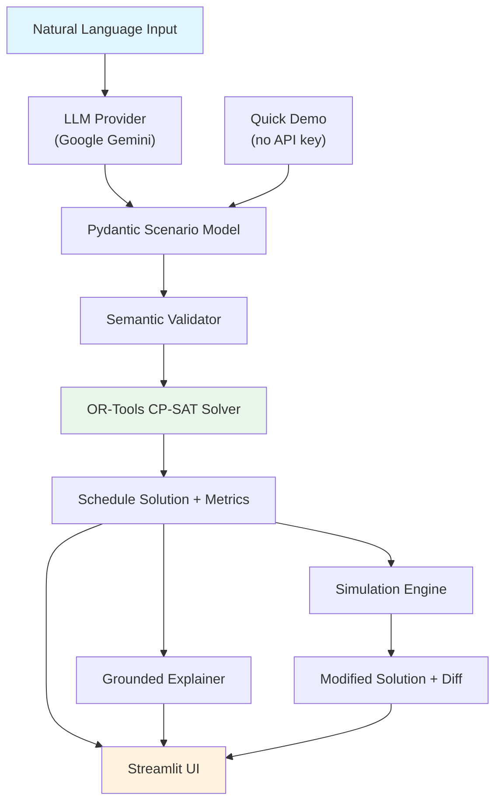

# SHIFT HAPPENS

**AI-Powered Decision & Simulation Engine for Employee Shift Scheduling**

## Problem Statement

Employee shift scheduling is a real-world combinatorial optimization problem. Manually assigning employees to shifts across multiple days, while respecting availability constraints, staffing requirements, workload limits, and employee preferences, is tedious, error-prone, and does not scale.

Shift Happens addresses this by combining natural-language understanding with deterministic optimization. Users describe their scheduling problem in plain English, and the system produces a provably valid schedule — or honestly reports that no feasible solution exists.

## Project Overview

Shift Happens is an AI-powered decision-support and simulation system built as a final-year CSE project. It demonstrates a principled architecture where:

- An **LLM** (Google Gemini) interprets the user's natural-language request into a structured representation.
- **Pydantic** validates the structure and data integrity of the parsed scenario.
- A **semantic validator** checks logical consistency (e.g., sufficient employees, feasible workload limits).
- The **OR-Tools CP-SAT solver** computes the actual schedule using constraint programming.
- A **simulation engine** supports what-if analysis by modifying scenarios and re-solving.
- A **Streamlit UI** provides an interactive interface with visualizations and explanations.

### Core Principle

> The LLM is **never** the source of truth for optimization decisions. All scheduling is performed by the deterministic OR-Tools CP-SAT solver. LLM output is treated as untrusted input and fully validated before reaching the solver.

## Key Features

- **Natural-language scheduling** — Describe your problem in plain English; the system handles the rest.
- **Deterministic optimization** — OR-Tools CP-SAT ensures solutions are provably correct.
- **Hard and soft constraints** — Express requirements (must-satisfy) and preferences (penalized in objective).
- **What-if simulation** — Modify scenarios (employee unavailability, staffing changes, workload adjustments) and compare results side-by-side.
- **Independent verification** — A separate verifier checks solver output against all constraints.
- **Grounded explanations** — Schedule summaries derived from actual solver data, not LLM generation.
- **Interactive visualizations** — Shift heatmaps, workload distribution charts, and coverage metrics.
- **Reproducible benchmark** — 35 fixed scenarios with automated solver, simulation, and verification evaluation.
- **Quick Demo mode** — Try the system without an API key using pre-built scenarios.

## Architecture



### Component Responsibilities

| Component | Responsibility |
|-----------|---------------|
| `llm/provider.py` | LLM abstraction — `GoogleGeminiProvider` for Gemini API, `MockLLMProvider` for testing |
| `parser/nl_parser.py` | NL text → validated `Scenario` with structured error taxonomy |
| `models/scenario.py` | Pydantic data models with cross-field validation |
| `models/solution.py` | Solution structure, solver status, assignments, metrics |
| `validation/validator.py` | Semantic feasibility checks beyond schema validation |
| `solver/scheduler.py` | OR-Tools CP-SAT model construction, solving, and metric extraction |
| `pipeline.py` | End-to-end orchestrator: parse → validate → solve |
| `simulation/engine.py` | Scenario modification, re-solving, and diff computation |
| `explanation/explainer.py` | Grounded text explanations from solver data (no LLM) |
| `ui/app.py` | Streamlit web application with visualizations |
| `benchmark/` | Reproducible evaluation with 35 fixed scenarios |
| `cli.py` | Command-line interface for the pipeline |

## Technology Stack

| Technology | Purpose |
|------------|---------|
| Python 3.10+ | Core language |
| Pydantic 2.x | Data models, validation, JSON schema generation |
| Google OR-Tools CP-SAT | Constraint programming solver |
| Pandas | Data manipulation for tables and metrics |
| Streamlit | Web UI framework |
| Plotly | Interactive visualizations |
| Google Gemini API | Natural-language interpretation (optional) |
| Pytest | Test framework |

## Project Structure

```
shift_happens/
├── models/
│   ├── scenario.py          # Pydantic input models
│   └── solution.py          # Pydantic output models
├── solver/
│   └── scheduler.py         # OR-Tools CP-SAT scheduler
├── validation/
│   └── validator.py         # Semantic validation
├── llm/
│   └── provider.py          # LLM provider abstraction
├── parser/
│   └── nl_parser.py         # NL → Scenario parser
├── simulation/
│   └── engine.py            # What-if simulation engine
├── explanation/
│   └── explainer.py         # Grounded schedule explanations
├── benchmark/
│   ├── dataset.py           # 35 fixed benchmark scenarios
│   ├── runner.py            # Benchmark execution and metrics
│   ├── verifier.py          # Independent constraint verification
│   ├── report.py            # JSON, CSV, and text reporting
│   └── cli.py               # Benchmark CLI
├── ui/
│   └── app.py               # Streamlit application
├── pipeline.py              # End-to-end orchestrator
└── cli.py                   # Pipeline CLI

tests/
├── test_models.py           # Model validation tests
├── test_solver.py           # Solver correctness tests
├── test_validator.py        # Semantic validation tests
├── test_parser.py           # NL parsing tests
├── test_pipeline.py         # Pipeline integration tests
├── test_simulation.py       # Simulation engine tests
├── test_ui.py               # UI data transformation tests
└── test_benchmark.py        # Benchmark evaluation tests

docs/
├── ARCHITECTURE.md          # System architecture
├── DECISIONS.md             # Design decisions
├── ROADMAP.md               # Development roadmap
├── EVALUATION.md            # Evaluation methodology
└── DEV_LOG.md               # Development log
```

## Installation

### Prerequisites

- Python 3.10 or later
- pip

### Setup

```bash
# Clone the repository
git clone <repository-url>
cd SHIfT_HAPPENS

# Create and activate a virtual environment
# Linux/macOS:
python -m venv .venv
source .venv/bin/activate

# Windows PowerShell:
python -m venv .venv
.venv\Scripts\Activate.ps1

# Install dependencies
pip install -r requirements.txt

# Or install as editable package with dev dependencies:
pip install -e ".[dev]"
```

### Gemini API Configuration (Optional)

Natural Language mode requires a [Google Gemini API key](https://aistudio.google.com/apikey). Quick Demo mode works without one.

```bash
# Linux/macOS:
export GEMINI_API_KEY="your-api-key-here"

# Windows PowerShell:
$env:GEMINI_API_KEY = "your-api-key-here"
```

> [!NOTE]
> The API key is only needed for Natural Language mode and live NL benchmark evaluation. All tests, the Quick Demo, and the default benchmark run without it.

## Usage

### Streamlit UI (Recommended)

```bash
python -m streamlit run shift_happens/ui/app.py
```

The UI provides two modes:

- **Natural Language Mode** — Type a scheduling request in plain English (requires `GEMINI_API_KEY`). The system parses, validates, solves, and displays the schedule with metrics and visualizations.
- **Quick Demo Mode** — Select from pre-built scenarios and solve immediately. No API key required. Ideal for testing and demonstration.

Both modes support:
- Schedule tables organized by day and shift
- Shift heatmaps and workload distribution charts
- Coverage and utilization metrics
- Grounded explanations
- What-if simulation with side-by-side comparison

### CLI

```bash
# Solve a natural-language request (requires GEMINI_API_KEY):
python -m shift_happens.cli "Schedule 5 employees for 7 days with morning and night shifts."

# Read request from a file:
python -m shift_happens.cli --file request.txt

# Custom solver timeout:
python -m shift_happens.cli --timeout 30 "..."
```

### Python API

```python
from shift_happens.models.scenario import *
from shift_happens.solver.scheduler import solve

scenario = Scenario(
    num_days=3,
    employees=[Employee(id="alice", name="Alice"), Employee(id="bob", name="Bob")],
    shift_types=[ShiftType(name="morning"), ShiftType(name="night")],
    shift_requirements=[
        ShiftRequirement(day=d, shift_type=s, min_employees=1)
        for d in range(3) for s in ["morning", "night"]
    ],
)

solution = solve(scenario)
print(solution.status)       # optimal
print(solution.assignments)  # list of Assignment objects
print(solution.metrics)      # ScheduleMetrics
```

## What-If Simulation

The simulation engine allows modifying a solved scenario and comparing the results:

1. **Employee unavailability** — Mark an employee as unavailable on a specific day.
2. **Staffing changes** — Adjust minimum/maximum employees for a shift on a given day.
3. **Workload limit changes** — Modify max shifts, min days off, or consecutive day limits.

The engine creates a deep copy of the scenario, applies changes, re-solves, and produces a diff showing how assignments and metrics changed. The original scenario and solution are never mutated.

## Testing

```bash
# Run the full test suite:
python -m pytest -q

# Run a specific test file:
python -m pytest tests/test_solver.py -v

# Run with coverage:
python -m pytest --cov=shift_happens
```

All tests run fully offline without an API key. The `MockLLMProvider` provides deterministic behavior for parser and pipeline tests.

## Evaluation Benchmark

The benchmark evaluates the system against 35 fixed scenarios covering trivial, standard, constrained, infeasible, edge-case, and simulation scenarios.

```bash
# Run the default offline benchmark:
python -m shift_happens.benchmark

# View all options:
python -m shift_happens.benchmark --help

# Filter to specific cases:
python -m shift_happens.benchmark --filter sim

# Custom output directory and timeout:
python -m shift_happens.benchmark --output results/ --timeout 10

# Enable live NL evaluation (requires GEMINI_API_KEY):
python -m shift_happens.benchmark --live-nl
```

The benchmark evaluates:
- **Validation correctness** — Whether semantic validation correctly accepts/rejects each scenario.
- **Solver outcome** — Whether the solver produces the expected result (feasible or infeasible).
- **Independent verification** — Whether feasible solutions satisfy all constraints.
- **Simulation correctness** — Whether what-if simulations produce expected outcomes.
- **Original preservation** — Whether simulations leave original data unmodified.

Reports are generated in JSON, CSV, and text summary formats in the `benchmark_results/` directory.

> [!IMPORTANT]
> The default benchmark runs fully offline. NL parsing evaluation is disabled by default and requires the `--live-nl` flag with a valid API key.

## Limitations

- **LLM parsing quality** depends on the Gemini model and prompt. Complex or ambiguous requests may not parse correctly.
- **Infeasibility diagnosis** is a best-effort heuristic — the solver reports infeasibility but cannot always identify the specific conflicting constraints.
- **No multi-day constraint linking** (e.g., "Alice works Monday so she must be off Tuesday") beyond what the workload limits express.
- **Single scheduling domain** — designed for employee shift scheduling. The architecture supports extension to other domains but this is not implemented.
- **No persistent storage** — each session starts fresh. Scenarios and solutions are not saved between runs.
- **No authentication or multi-user support** — this is a single-user academic project.

## License

Academic project — Final Year CSE.
