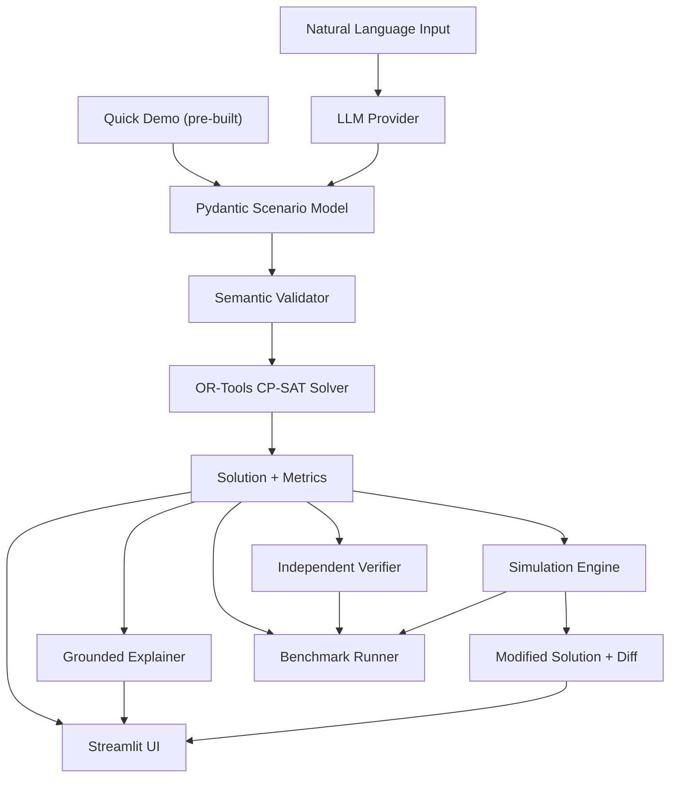

# Architecture

## Overview

Shift Happens follows a layered pipeline architecture where each component has a single responsibility. The LLM interprets, Pydantic validates, the semantic validator checks feasibility, and the OR-Tools solver makes all scheduling decisions.



## Module Responsibilities

### models/
Pydantic models defining the data contracts:
- `scenario.py` — Input: employees, shifts, constraints, requirements, workload limits. Includes cross-field referential integrity validation.
- `solution.py` — Output: assignments, solver status, objective value, schedule metrics, per-employee metrics.

### solver/
`scheduler.py` — Translates a `Scenario` into an OR-Tools CP-SAT model:
- Boolean variables `x[employee, day, shift]`
- Hard constraints (one-shift-per-day, staffing minimums, availability, shift restrictions, max employees cap)
- Soft constraints (penalties in objective for preferences)
- Workload limits (max/min shifts, consecutive days, days off)
- Workload balancing objective
- Returns `ScheduleSolution` with assignments and metrics

### validation/
`validator.py` — Semantic checks beyond Pydantic schema validation:
- Staffing feasibility (enough employees for requirements)
- Workload limit consistency (min shifts vs. available days, days off feasibility)
- Missing requirement warnings
- Returns `ValidationResult` with `.valid`, `.errors`, `.warnings`

### llm/
`provider.py` — LLM provider abstraction layer:
- `LLMProvider` — Abstract interface for obtaining structured scheduling data
- `GoogleGeminiProvider` — Concrete implementation using Google Gemini API
- `MockLLMProvider` — Deterministic provider for testing (no network calls)
- `ProviderError` — Exception for API/configuration failures
- Embeds the Pydantic `Scenario` JSON schema in the system prompt
- API key via `GEMINI_API_KEY` environment variable (never hardcoded)

### parser/
`nl_parser.py` — Natural language → validated `Scenario` pipeline:
- `parse_natural_language(text, provider)` — Main entry point
- Returns `ParseResult` with explicit error categories:
  - `EMPTY_INPUT` — No text provided
  - `PROVIDER_ERROR` — LLM API failure
  - `INVALID_JSON` — LLM returned non-dict output
  - `NOT_SCHEDULING` — LLM identified a non-scheduling request
  - `SCHEMA_ERROR` — Output doesn't match Pydantic Scenario model
  - `SEMANTIC_ERROR` — Valid structure but logically infeasible
- Successful results include a solver-ready `Scenario` and any warnings

### pipeline.py
End-to-end orchestration:
- `schedule(request, provider)` — Single entry point for NL → schedule
- Chains: parser → validator → solver
- Returns `PipelineResult` with status:
  - `SUCCESS` — Parsed and solved (optimal or feasible)
  - `INFEASIBLE` — Parsed OK, but no feasible schedule exists
  - `PARSE_FAILED` — Could not produce a valid Scenario
  - `SOLVER_ERROR` — Solver crashed or timed out
  - `INTERNAL_ERROR` — Unexpected exception
- Invalid scenarios never reach the solver

### cli.py
Minimal CLI for running the pipeline:
- `python -m shift_happens.cli "Schedule 5 employees..."`
- `python -m shift_happens.cli --file request.txt`
- Requires `GEMINI_API_KEY` environment variable

### simulation/
`engine.py` — What-if scenario modification and comparison:
- `simulate(scenario, baseline_solution, changes)` → `SimulationResult`
- Change types: `SetEmployeeUnavailable`, `ChangeStaffingRequirement`, `ChangeWorkloadLimit`
- Deep-copies scenario before modification (original preserved)
- Re-solves and produces assignment diff and metrics diff
- Returns `SimulationStatus`: `SUCCESS`, `INFEASIBLE`, `INVALID_CHANGE`, `VALIDATION_FAILED`

### explanation/
`explainer.py` — Grounded explanation from solver data:
- `explain_schedule(scenario, solution)` — Multi-paragraph text summary
- `explain_simulation(baseline, modified, changes)` — Comparison explanation
- Every statement derived from actual Scenario and Solution objects
- No LLM calls — purely data-driven

### ui/
`app.py` — Streamlit web interface:
- Natural Language mode (requires API key) and Quick Demo mode (no API key)
- Schedule tables, shift heatmaps, workload distribution charts
- Coverage and utilization metrics
- What-if simulation with side-by-side comparison
- Grounded text explanations

### benchmark/
Reproducible evaluation suite:
- `dataset.py` — 35 fixed scenarios across 12 categories
- `runner.py` — Benchmark execution with solver, simulation, and NL evaluation
- `verifier.py` — Independent constraint verification (separate from solver)
- `report.py` — JSON, CSV, and text summary report generation
- `cli.py` — CLI entry point with filtering, timeout, and output directory options

## Data Flow

### End-to-End Pipeline
```
Natural-language text
  → LLMProvider.parse_scenario()  → raw dict (untrusted)
  → Scenario.model_validate()     → Pydantic schema checks
  → validate_scenario()           → semantic feasibility checks
  → solve()                       → OR-Tools CP-SAT optimization
  → PipelineResult                → status + scenario + solution + metrics
```

### Simulation Flow
```
Scenario + Baseline Solution + Changes
  → deep copy scenario
  → apply changes (unavailability, staffing, workload)
  → validate_scenario() on modified scenario
  → solve() modified scenario
  → compute assignment diff + metrics diff
  → SimulationResult
```

### Failure Modes
```
Empty input          → PARSE_FAILED (EMPTY_INPUT)
API failure          → PARSE_FAILED (PROVIDER_ERROR)
Bad JSON from LLM    → PARSE_FAILED (INVALID_JSON)
Non-scheduling input → PARSE_FAILED (NOT_SCHEDULING)
Schema mismatch      → PARSE_FAILED (SCHEMA_ERROR)
Semantically invalid → PARSE_FAILED (SEMANTIC_ERROR) — solver NOT called
Solver infeasible    → INFEASIBLE — constraints conflict
Solver crash/timeout → SOLVER_ERROR
```

## Constraint Model

- **Hard constraints**: Must be satisfied. Solver reports infeasible if impossible.
- **Soft constraints**: Penalized in objective. Solver minimizes total penalty.

The solver never invents a schedule. If infeasible, it reports why.

## Trust Boundaries

The LLM's output is always treated as **untrusted input**:
1. The LLM produces a raw dict — never Python code or solver instructions
2. Pydantic validates the dict against the Scenario schema
3. Semantic validation checks logical feasibility
4. Only a fully validated Scenario reaches the deterministic solver

## Benchmark Architecture

The evaluation benchmark is independent from the main pipeline:
- Scenarios are fixed at dataset creation time (no runtime generation)
- The solver is called directly on pre-built Scenario objects
- An independent verifier re-checks all constraints on solver output
- Validation-rejected cases are tracked separately from solver outcomes
- NL evaluation is optional and disabled by default
